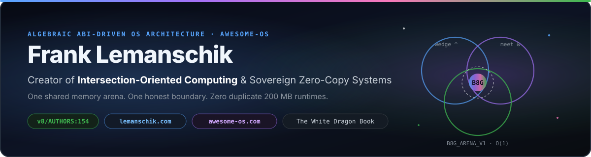
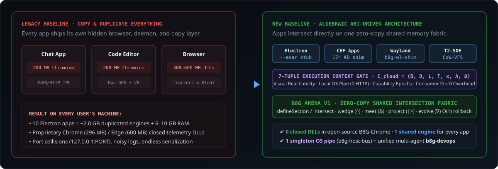

  

  <a href="https://lemanschik.com"><strong>lemanschik.com</strong></a> ·
  <a href="https://awesome-os.com"><strong>awesome-os.com</strong></a> ·
  <a href="mailto:frank@dspeed.eu"><strong>frank@dspeed.eu</strong></a>

---

## The New Baseline: Algebraic ABI-Driven OS Architecture

Modern computers are **100× faster** than the machines we grew up on — yet opening a chat app, a code editor, and a web browser still eats **10 GB of RAM**, **2+ GB of duplicated disk space**, and spins up your fans.

**Why?** Because the software industry normalized **copying everything**:
- Every Electron app ships its own **~200 MB private copy of Chromium**.
- Every proprietary browser piles **300–600 MB of closed telemetry, auto-updaters, shopping sidebars, and hidden AI DLLs** on top of open-source Chromium.
- Every microservice and local tool binds random `127.0.0.1` ports, copies JSON back and forth, and dumps developer warnings into the laps of normal users.

**That era is over.**

I am the creator of **Algebraic ABI-Driven OS Architecture** *(Intersection-Oriented Computing)* — the foundation of **Awesome-OS / `B8G`** and **StealifyLang**. Instead of piling more frameworks on top of broken abstractions, we treat the **binary boundary (ABI) and shared memory layout** as the primary, mathematically verified source of truth.

  

---

## Honest Lineage — Standing on Giants, Going One Level Deeper

Real systems engineering never exaggerates. Binary-first boundaries have respected predecessors:
- **Microsoft COM / WinRT** *(1993+)* proved language-agnostic binary vtable ABIs.
- **Google Fuchsia / Zircon FIDL** *(2016+)* proved capability-gated, ABI-first IPC.
- **WASI Component Model / WIT** *(2022+)* proved canonical cross-language sandbox ABIs.
- **Apache Arrow, Cap'n Proto & seL4** proved zero-copy layouts and formal capability tokens.

**What is genuinely first-of-its-kind in Awesome-OS / B8G** is unifying all three of these breakthroughs into **one coherent, algebraic operating fabric**:

### 1. Zero-Copy *Intersection-Oriented* ABI (Not Message Passing)
Even the best legacy ABIs still *serialize and copy messages* across walls. In B8G, overlapping apps and OS services literally **intersect** (`defineSection` / `intersect`) onto the **exact same 64-byte-aligned `B8G_ARENA_V1` memory slots** using four simple algebraic operators:
- **`wedge (^)`** — Composes orthogonal sections (field collisions are impossible by construction).
- **`meet (&)`** — Monotonically narrows security capabilities (authority can *only* shrink, never escalate).
- **`project (|>)`** — Separates full-speed internal execution from paced legacy OS host boundaries.
- **`evolve (∇)`** — Advances Copy-on-Write epochs with **O(1) instant rollback**.

### 2. The 7-Tuple Execution Context Algebra & Zero-Cost Consumer Mode
Every window, service, and build runs inside one formal contract:

> **`C_cloud = (Boundary, Display, Lifetime, Transport, Capability, Locality, Persona)`**

This single equation eliminates whole categories of real-world bugs before code even runs:
- **No invisible GUIs:** An operation requiring a visible foreground window cannot silently pretend to succeed from a headless background job.
- **No `EADDRINUSE` / port chaos:** Local tools share **one singleton OS Named Pipe / Unix Socket** (`b8g-host-bus`), never random loopback HTTP servers.
- **No accidental cloud leaks:** Private data is mathematically pinned inside your local machine or LAN (`Locality <= lan-peer`).
- **Zero-Cost Consumer Mode (`Persona = consumer ⇒ ∅`):** Normal users pay **0 CPU, 0 RAM, and 0 console noise** for telemetry or developer warnings. Engineers and autonomous AI agents attach orthogonally to **one centralized `b8g-devops` hub** that routes P0–P3 emergencies to specialist worker units with zero duplicate firefighting.

### 3. Full-Stack Strangler-Fig Virtualization (Keep Your Existing Software, Drop the Bloat)
You do not have to rewrite the world on day one. We intercept the cleanest binary seam so existing software runs on **one shared open-source B8G engine**:
- **Installed Electron Apps:** Read `resources/app.asar` directly (`b8g-electron --asar`) with **zero mutation** of signed installs — turning 10 × 200 MB apps into **1 shared runtime**.
- **Installed CEF Apps:** Drop-in **`174 KB`** C-ABI `libcef.dll` shim (`b8g-cef-shim`) replacing ~200 MB embedded browsers.
- **Native GUI Toolkits & Legacy Binaries:** Zero-copy Wayland-to-Arena shim (`b8g-wl-shim`), 4-tier Win64/DOS/.NET binary boxing, and **7-arch T2-SDE CoW-VFS overlays** (`t2-sde-b8g`) with `web-posix` + O(1) rollback.

---

## Why This Clicks Instantly: The Empirical Browser Stack Audit

People always ask *"How much bloat is really hidden inside everyday software?"*
Here is a **machine-verified binary audit** comparing open-source **Chromium**, **Google Chrome**, **Microsoft Edge**, and our sovereign open-source **`B8G-Chrome`** on the exact same Windows 11 machine:

| Distribution | License | Core Engine DLL(s) | `resources.pak` | Notable Proprietary Additions Found on Disk |
| :--- | :---: | :--- | :---: | :--- |
| **Google Chrome** `157.0.8103.79` | Closed | `chrome.dll` (**296.10 MB**) | `25.06 MB` | `optimization_guide_internal.dll` (24.29 MB), `libLiteRtWebGpuAccelerator.dll` (9.57 MB), `elevated_tracing_service.exe`, `os_update_handler.exe`, `WidevineCdm/` |
| **Microsoft Edge** `158.0.4370.33` | Closed | `msedge.dll` (**367.81 MB**) + `msedge_renderer.dll` (**232.07 MB**) = **599.88 MB** | `35.62 MB` | `mspdf.dll` (18.27 MB), `onnxruntime.dll` (11.13 MB), `mip_core_gn.dll` (8.24 MB), `oneauth.dll` (6.38 MB), `dual_engine_adapter_x64.dll` (5.59 MB), `telclient.dll`, `oneds.dll`, `EBWebView/` |
| **`B8G-Chrome`** *(Awesome-OS)* | **BSD-3 Open Source** | Modular open-source Chromium components | **`21.19 MB`** | **Zero closed DLLs** — `0` telemetry, `0` background updaters, `0` DRM blobs, `0` closed AI sidebars |

When you see **599.88 MB** of closed browser DLLs next to **zero**, the entire philosophy clicks in five seconds: **software does not have to be heavy, opaque, or wasteful.**

---

## Books & Projects

- **Awesome-OS / `B8G`** — Sovereign, zero-copy, algebraic operating system & runtime fabric → [awesome-os.com](https://awesome-os.com)
- **The White Dragon Book** — Engineering manifesto on Post-Neumann compilation, zero-header ABIs, and strangler-fig binary boundaries.
- **The Little White Dragon & The Honest Machine** — Illustrated storybook starring **Lumi the Little White Dragon**, teaching kids (ages 8–14) how computers *really* work underneath the shiny boxes.
- **V8 Contributor** — Listed in Google V8 `AUTHORS` (`v8/AUTHORS:154`).

---

  <em>„Nunquam ante, numquam iterum“</em> — Pay a hard architectural cost once, crystallize it behind an honest boundary, and never pay it again.

