  

  <a href="https://awesome-os.com"><strong>awesome-os.com</strong></a> &nbsp;·&nbsp;
  <a href="https://b8g.app"><strong>b8g.app</strong></a> &nbsp;·&nbsp;
  <a href="https://lemanschik.com"><strong>lemanschik.com</strong></a> &nbsp;·&nbsp;
  <a href="https://github.com/awesome-os"><strong>github.com/awesome-os</strong></a>

---

### What I'm Building

- **[Sectium](https://github.com/awesome-os/chromium.googlesource.com)** — Open-source BSD-3 Chromium-derived core engine (`0` closed Google/Microsoft DLLs, `sectium-minimal-7` 7-subtree allowlist, unified `/shell` default interaction shell).
- **[Awesome-OS](https://github.com/awesome-os/awesome-os)** — Sovereign content-addressed operating system & runtime built on zero-copy `SharedArrayBuffer` arenas (`B8G_ARENA_V1`), SHA-256 `.b8p` CAS packs, and $O(1)$ Copy-on-Write epoch-pointer rollbacks.
- **Heterogeneous MoE Kernel, Attention & Model Research (`b8g-moe-gate`, `Xenon 1B`, `AtlasKV`)** — Boundary-verified Mixture-of-Experts routing and model-kernel attention mixing heterogeneous local & cloud models (GGUF/llama.cpp, Unsloth LoRA, Jina-v3 dual-adapter Matryoshka embeddings, `lumiBERT` sub-5 ms deterministic error auto-repair, and `B8G Xenon 1B` with hierarchical `AtlasKV` KV-memory) under unified `CapabilityToken` & safe-gate isolation.
- **First-Class Google Antigravity, AI Studio & Colab GPU Mesh Integrations** — Reload-proof persistent agent daemon (`b8g-agent-host`) bridging the official `google-antigravity` SDK + VS Code UI-in-UI workbench + Sectium's default `/shell`, paired with **Google AI Studio / Gemini** workflows and **Google Colab (T4/L4/A100/TPU)** runtime nodes wired directly into our `CloudDeviceMesh` with one-click nbformat v4.5 `.ipynb` & Unsloth LoRA exports (`b8g-llm-studio`).
- **Zero-WSL Native Cross-Compilation** — Building Win64 PE, Linux ELF64, and WASI targets natively via `zig cc`/`c++` and our zero-Ninja DAG executor (`b8g-dag-build`).
